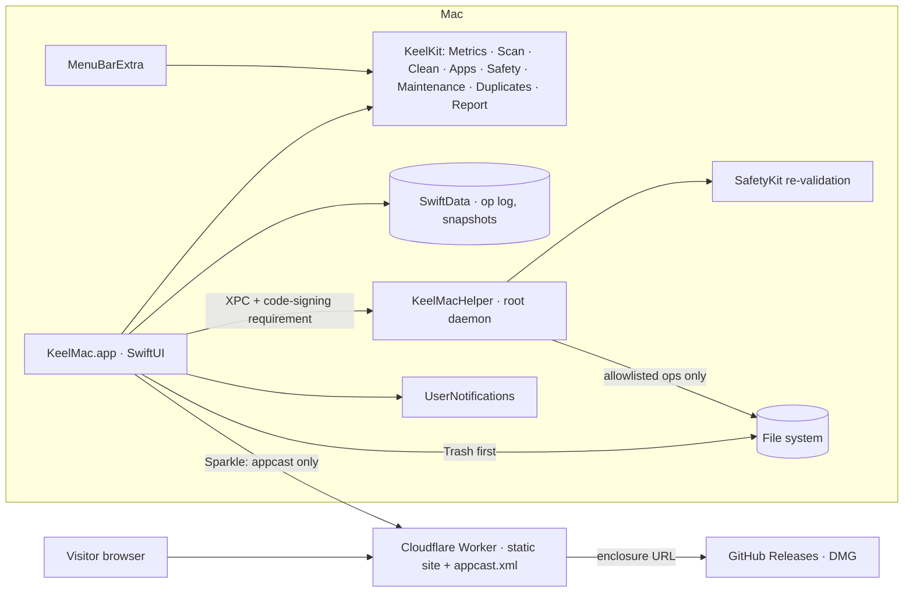

# Stack · KeelMac

> Decided 2026-10-22. Limits and versions verified 2026-10-22: Cloudflare Workers limits and pricing (developers.cloudflare.com/workers/platform/limits, /pricing), Sparkle latest release via GitHub API (2.10.0, published 2026-09-13), Mole licence (GPL-3.0). Local toolchain checked the same day: Xcode 27.1 (27A9275), Swift 6.4, macOS 27.0 SDK, XcodeGen installed, Wrangler 4.107.0, gh logged in as DarthQach, signing identity "Apple Development: CARLOS VILLEGAS FROLA".

## Decision
KeelMac is a **native macOS app with no backend** (variant E · Native macOS). The spec fixes the platform: Swift 6 and SwiftUI with AppKit where needed, a menu bar extra, a privileged helper registered with `SMAppService.daemon`, and SwiftData for local history. All logic lives in one local Swift package, **KeelKit**, split into the spec's modules (MetricsKit, ScanKit, CleanKit, AppsKit, SafetyKit, plus MaintenanceKit, DuplicatesKit, ReportKit and HelperShared) so the app, the helper and the tests share one implementation of every safety check. The app-forge vendor order has little to do here: there are no accounts (Clerk not used), no payments (Stripe not used), no server state. **Cloudflare's job is a static Worker** serving the landing page, the Sparkle appcast and release notes.

## Stack
| Layer | Choice | Why |
|---|---|---|
| Platform | macOS 14.0 minimum, built with the macOS 27 SDK; universal binary (arm64 + x86_64) | Spec §5: SwiftUI, `MenuBarExtra`, `SMAppService` maturity; Intel best-effort |
| Language | Swift 6 language mode, strict concurrency | Spec §6; current toolchain is Swift 6.4 |
| UI | SwiftUI (`NavigationSplitView`, `Table`, `Charts`), AppKit bridges for Quick Look (`QLPreviewPanel`), drag-and-drop and `NSWorkspace` | Native look, light/dark automatic |
| Menu bar | `MenuBarExtra` with `.window` style popover | Spec §6 |
| Project | XcodeGen (`project.yml` → `KeelMac.xcodeproj`, generated, not committed) | Text-diffable targets, helper embedding and build phases |
| Shared logic | `Packages/KeelKit` local Swift package with one library product per module | Testable with `swift test` in seconds; helper links SafetyKit so it re-validates paths with the same code |
| CPU / RAM | Mach `host_statistics64` (`HOST_VM_INFO64`), `host_processor_info`, `sysctl` (`vm.memory_pressure`, `kern.boottime`, `hw.memsize`), `libproc` (`proc_listpids`, `proc_pidinfo`, `proc_pid_rusage`) | Spec §6 |
| Battery | IOKit `AppleSmartBattery` registry properties (`CycleCount`, `AppleRawMaxCapacity`, `DesignCapacity`, `Temperature`, `IsCharging`, `AdapterDetails`) + `IOPSCopyPowerSourcesInfo` for condition | Spec FR-3 |
| Temperature | IOHID temperature sensor services (`IOHIDEventSystemClient`, resolved with `dlsym`, as Stats does on Apple silicon); battery temperature from `AppleSmartBattery` as fallback | No public API; "Unavailable" when it can't be read |
| Network | `getifaddrs` byte counters (`if_data`) | No entitlement, no network calls |
| Disk scanning | `getattrlistbulk` walker over a task group, `URLResourceValues` for totals, `statfs` for volumes | Spec §6; meets the < 60 s target |
| Treemap / sunburst | Custom SwiftUI `Canvas` (squarified treemap, radial sunburst) | Spec §6 |
| Charts | Swift Charts for 60-minute mini charts | Native |
| Cleanup rules | `CleanKit/Resources/cleanup-rules.json` (versioned schema), loaded at launch | Spec §7: rules as data, PR-friendly |
| Safety | `SafetyKit`: protected path list, whitelist matcher, symlink/firmlink resolution, "provably safe" check, Trash-first executor via `FileManager.trashItem` | Spec C14 and FR-8 |
| Persistence | SwiftData (`OperationRecord`, `StorageSnapshot`, `SnapshotEntry`) in `~/Library/Application Support/KeelMac/KeelMac.store`; settings in `UserDefaults` | Spec §6 |
| Privileged ops | `KeelMacHelper` command-line daemon in `Contents/MacOS`, launchd plist in `Contents/Library/LaunchDaemons`, registered with `SMAppService.daemon(plistName:)`; `NSXPCConnection` over a Mach service with `setCodeSigningRequirement` on both sides (macOS 13+) | Spec FR-11; helper runs only named operations from an enum |
| Apps | `NSWorkspace`, Spotlight metadata (`kMDItemLastUsedDate` via `NSMetadataQuery`/`MDItem`), `FSEvents` watcher on `~/.Trash` | C16–C20 |
| Login items | Enumerate `~/Library/LaunchAgents`, `/Library/LaunchAgents`, `/Library/LaunchDaemons`; `launchctl` for enable/disable (user domain directly, system domain through the helper); `SMAppService.statusForLegacyPlist` where available | C19 |
| Duplicates | Size buckets → first/last 64 KB hash → full SHA-256 (CryptoKit) | C23 |
| Notifications | `UserNotifications`, local only | C7, C25 |
| Launch at login | `SMAppService.mainApp` | C26 |
| Updates | Sparkle 2.10.0 via SPM, EdDSA-signed appcast at `https://keelmac.<account>.workers.dev/appcast.xml`, `SUPublicEDKey` in Info.plist | Spec FR-12 |
| Localization | String Catalog (`Localizable.xcstrings`), en + es | Spec §4 |
| Tests | Swift Testing in KeelKit (rules, safety, planner dry-run snapshots, treemap layout, hashing, matchers) with temp-directory fixtures; XCUITest happy path for the app | Spec §6 |
| Lint/format | `swift format lint` (bundled with the toolchain) | No extra dependency |
| CI | GitHub Actions `macos-15` (latest available) runners: build + test on push; release workflow on tags (Developer ID sign, notarize with `notarytool`, DMG via `hdiutil`, appcast via Sparkle `generate_appcast`) | Spec §6, §8 |
| Packaging | DMG built with `hdiutil` (no extra tool), Homebrew cask file `Casks/keelmac.rb` | Spec §8; `create-dmg` is not installed and `hdiutil` needs nothing |
| Landing page | Cloudflare Worker with static assets on workers.dev: `/`, `/es/`, `/appcast.xml`, `/releases/`, `/privacy/` | Static asset requests are free and unlimited |
| Observability | None in the app (zero telemetry). Workers Logs for the site | Privacy principle |

## Capability map
| Capability | Service(s) | Notes |
|---|---|---|
| C1 Health Score | `ReportKit.HealthScore` (pure function of a `HealthInputs` snapshot) + cached last inputs in UserDefaults | Rendered from cache immediately, refreshed in the background |
| C2 Factor fixes | `HealthScore.Factor.fix` → app navigation actions | Fix opens the right screen pre-filtered |
| C3 Summary cards | MetricsKit + `ProcessInfo` + `sysctl` (`machdep.cpu.brand_string`, `hw.model`) | |
| C4 Menu bar | `MenuBarExtra`, `MetricsSampler` actor on a configurable timer | Sampler pauses heavy probes when popover closed |
| C5 Popover charts, top processes | `MetricsHistory` ring buffer (60 min), `ProcessSampler` (libproc), `NSRunningApplication.terminate` / `kill(SIGTERM)` | Quit asks first for non-app processes |
| C6 Battery | MetricsKit `BatteryReader` (IOKit) | Desktop Macs show "No battery" |
| C7 Alerts | `AlertEngine` (pure, testable) + UserNotifications | Hysteresis so alerts don't repeat |
| C8 Scan, treemap, sunburst | ScanKit `DiskScanner` (`getattrlistbulk`), `TreemapLayout`, `SunburstLayout`, scan cache for incremental rescan (directory mtimes) | Cancel via task cancellation |
| C9 Large & old files | ScanKit index over the scan tree, `kMDItemLastUsedDate` with access-date fallback | |
| C10 System Data | ScanKit `SystemDataBreakdown` (known folders: `/private/var/vm`, `/Library/Caches`, `~/Library/Caches`, APFS local snapshots via `tmutil listlocalsnapshots`, `/private/var/folders`, logs, Xcode, simulators) | |
| C11 File actions | `NSWorkspace.activateFileViewerSelecting`, `QLPreviewPanel`, SafetyKit Trash executor | |
| C12 Categories | CleanKit rules JSON + `RuleEvaluator`; command-type rules (Homebrew, Docker, simctl) run via `Process` with fixed arguments | |
| C13 Dry run | CleanKit `CleanupPlanner` → `CleanupPlan` (every item, size, reason) | Executor only accepts a plan's item ids |
| C14 Safety | SafetyKit `PathGuard` (protected list, whitelist, symlink resolution), checked again in executor and helper | Tests prove protected/whitelisted paths are never touched |
| C15 Operation log | SwiftData `OperationRecord`; export CSV/JSON/Markdown | |
| C16 Uninstall | AppsKit `RelatedFileMatcher` (bundle id, name, team id) | Preview list, then Trash |
| C17 Orphans | AppsKit `OrphanFinder` (Library entries whose bundle id matches no installed app) | Conservative: Apple and system ids excluded |
| C18 Drop zone, watcher | SwiftUI `onDrop`, `FSEventStream` on `~/.Trash` | Watcher off by default |
| C19 Login items | AppsKit `LaunchItemStore` | Disable = `launchctl bootout` + `disable`; remove = Trash the plist |
| C20 App list | AppsKit `AppInventory` (`/Applications`, `~/Applications`) | Size via directory walk |
| C21 Maintenance | MaintenanceKit `MaintenanceTask` catalogue (description, exact command, needsAdmin) | User-level tasks run in-app, admin tasks via helper |
| C22 Helper | `KeelMacHelper` + `HelperShared` protocol + SafetyKit | Allowlist enum; code-signing requirement on the connection |
| C23 Duplicates | DuplicatesKit `DuplicateFinder`, `AutoSelectRule` | |
| C24 Snapshots | ReportKit `SnapshotTaker` (top folders from a shallow scan), SwiftData, weekly schedule (`NSBackgroundActivityScheduler`) | |
| C25 Weekly report | ReportKit `WeeklyReport` → notification + Markdown export | |
| C26 Settings | `UserDefaults` via `@AppStorage`, `SMAppService.mainApp` | |
| C27 FDA onboarding | `FullDiskAccess.probe()` (read a TCC-protected file), deep link `x-apple.systempreferences:com.apple.preference.security?Privacy_AllFiles` | |
| C28 Coffee | `CoffeePrompt` policy (≥ 2 GB, ≥ 30 days, dismiss forever), link constant | |
| C29 Updates | Sparkle `SPUStandardUpdaterController` | Feed is the only network call KeelMac makes on its own |
| C30 EN/ES, a11y | String Catalog, accessibility labels | |
| C33 Assistant | AssistantKit `OllamaClient` (streaming `/api/chat` with tools over `URLSession`) + `ChatSession` tool loop; app-side `AssistantModel`, `ScreenContext`, eight read-only tools; resizable trailing panel below the toolbar (`AssistantSplit`, not `.inspector`, so screen toolbars stay over their content) | Local Ollama only, off by default; loopback over http, anything else https; tools never remove, run or change anything; metadata only |
| C31 Repo + CI | GitHub, Actions, cask | Repo private until Carlos flips it |
| C32 Landing | Cloudflare Worker static assets | |

## AWS (gap services)
| Capability | AWS service | Cloudflare can't because… |
|---|---|---|
| — | none | No server-side capability is needed |

## Not used, and why
| Vendor / product | Reason |
|---|---|
| Clerk | No accounts (spec: "no account") |
| Stripe | Free app; Buy Me a Coffee is an outbound link |
| D1, KV, R2, Queues | No server state. The DMG is attached to GitHub Releases (no 25 MiB asset limit problem); the appcast points there |

## How it works

## Data model (draft)
| Model | Key fields | Relations | Written by |
|---|---|---|---|
| `OperationRecord` (SwiftData) | id, date, kind (clean, uninstall, trashFile, maintenance, loginItem), path, bytes, result (trashed, deleted, skipped, failed), reason, batchID | batchID groups one run | CleanKit/AppsKit/Maintenance executors |
| `StorageSnapshot` (SwiftData) | id, date, volumeTotal, volumeFree, batteryMaxCapacity | entries 1→n | SnapshotTaker (weekly + manual) |
| `SnapshotEntry` (SwiftData) | path, bytes | snapshot n→1 | SnapshotTaker |
| Scan cache (JSON file) | root, node tree (name, size, mtime, children) | | DiskScanner |
| Health cache (UserDefaults) | last `HealthInputs` and date | | Dashboard refresh |
| Settings (UserDefaults) | menu bar items, interval, thresholds, units, exclusions, whitelist, deleteMode, watcherEnabled, coffee state | | Settings screen |
| Cleanup rules (bundled JSON) | id, category, title, description, paths/globs, minAgeDays, needsAdmin, kind (paths, command), optIn, safetyNote | | Contributors via PR |

## Cost estimate (monthly, USD)
| Line item | Launch | 1k active users | 50k active users |
|---|---|---|---|
| Cloudflare Workers (static assets only; free and unlimited) | 0 | 0 | 0 |
| GitHub (repo, Releases; Actions macOS minutes on a private repo count 10×) | 0 | 0 | 0 (public repo: Actions free) |
| Apple Developer Program (needed for Developer ID + notarization) | 8.25 (99/yr) | 8.25 | 8.25 |
| Clerk / Stripe / AWS | 0 | 0 | 0 |
| **Total** | **8.25** (0 if shipped unsigned) | **8.25** | **8.25** |

Workers Paid is not needed: the site has no Worker script, only static assets, so the Free plan's 100,000 requests/day limit doesn't apply to it.

## Security
| Concern | Control |
|---|---|
| Deleting the wrong thing | Dry-run plan required; executor accepts only plan item ids; `PathGuard` runs before every move/delete (app and helper); protected list hard-coded; whitelist; symlinks resolved; Trash-first; every action logged |
| Helper abuse | Helper exposes a fixed enum of operations, no shell strings; `NSXPCListener.setConnectionCodeSigningRequirement` accepts only KeelMac signed by the same team; helper re-validates paths with SafetyKit |
| Process quitting | Only processes owned by the current user; system processes refused; confirmation for non-app processes |
| Updates | Sparkle EdDSA signatures; HTTPS feed; private key only in Carlos's keychain / GitHub Actions secrets |
| Secrets in a public repo | No secrets in the repo; signing cert, notary credentials and Sparkle key only as Actions secrets; `.gitignore` covers key files |
| Privacy | No network calls except the appcast and, when the Assistant is enabled, the user's local Ollama (`http://localhost:11434` by default); no analytics SDKs; Sparkle system profiling disabled |

## Beta / watch list
- IOHID temperature sensors are undocumented and may change between macOS releases; the reader degrades to "Unavailable".
- `SMAppService.daemon` requires the user to approve the helper in System Settings › Login Items › Allow in the Background; the app shows that state and a button to open the pane.
- GitHub Actions `macos-*` runner images may lag the newest Xcode; CI builds with the newest Xcode on the image and the macOS 14 deployment target.

## Rejected alternatives
- Electron / Tauri / Rust core · spec says one Swift codebase.
- `SMJobBless` · deprecated since macOS 13; `SMAppService` replaces it.
- Mac App Store · sandbox blocks deep cleaning (spec non-goal).
- `create-dmg` · not installed; `hdiutil` does the job with no dependency.
- R2 for DMG hosting · GitHub Releases already hosts binaries for free, and Homebrew casks point there.

## Risks
- Helper can't be exercised without a signed build and Carlos's approval in System Settings · Unit-test the allowlist and validation; ship user-level maintenance tasks working without the helper; document the manual check.
- Scans without Full Disk Access miss protected folders · Show FDA state everywhere it matters; the scanner records "permission denied" folders and the UI lists them.
- Swift 6 strict concurrency friction with C APIs (IOKit, libproc) · Isolate C calls in small nonisolated readers that return `Sendable` value types.
- Accidental data loss from a bad rule · Rules are data with tests; planner snapshot tests over fixture trees; protected-path tests for every rule.
